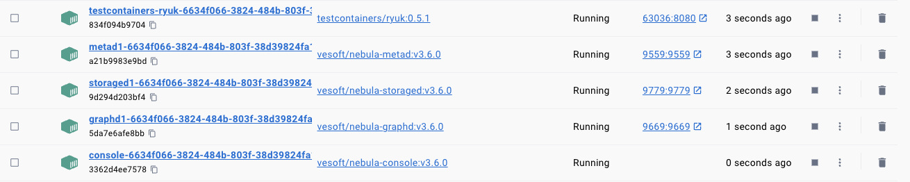

Testcontainers for NebulaGraph
---

![CI][Badge-CI] ![Nexus (Snapshots)][Badge-Snapshots] [![Sonatype Nexus (Releases)][Badge-Releases]][Link-Releases]

[Badge-CI]: https://github.com/nebula-contrib/testcontainers-nebula/actions/workflows/scala.yml/badge.svg
[Badge-Snapshots]: https://img.shields.io/nexus/s/io.github.jxnu-liguobin/testcontainers-nebula_3?server=https%3A%2F%2Foss.sonatype.org

[Badge-Releases]: https://img.shields.io/nexus/r/io.github.jxnu-liguobin/testcontainers-nebula_3?server=https%3A%2F%2Foss.sonatype.org
[Link-Releases]: https://oss.sonatype.org/content/repositories/releases/io/github/jxnu-liguobin/testcontainers-nebula_3/


[Testcontainers](https://github.com/testcontainers/testcontainers-java) is a Java library that supports JUnit tests, providing lightweight, throwaway instances of common databases, Selenium web browsers, or anything else that can run in a Docker container. 
It enables high-quality integration testing by ensuring environment consistency between development and production, isolating dependencies for each test group, and supporting parallel test execution.

[NebulaGraph](https://github.com/vesoft-inc/nebula) is a popular open-source graph database designed to handle large volumes of data with milliseconds of latency, scale quickly, and perform fast graph analytics. 
It is widely used in social media, recommendation systems, knowledge graphs, security, capital flow analysis, and AI applications.

This project, **Testcontainers for NebulaGraph**, combines these technologies to provide a seamless testing experience for NebulaGraph-based applications. 
It allows developers to run NebulaGraph clusters in Docker containers during tests, ensuring environment consistency and reducing setup overhead.


## ✨ Features

- **Full Cluster Support**: Spin up complete NebulaGraph clusters (including GraphD, MetaD, and StorageD services) with a single command.
- **Multi-Language Support**: Compatible with Java 8+ and Scala (2.12, 2.13, and 3).
- **Preconfigured Integration**: Includes default configurations for easy setup and usage with popular frameworks like ZIO through the `testcontainers-nebula-zio` module.
- **Docker-Based Isolation**: Each test runs in an isolated container, ensuring no shared state between test groups and avoiding port conflicts.
- **Production Consistency**: Mirrors production environments accurately, reducing bugs caused by environment discrepancies.
- **Flexible Deployment**: Supports single-node and multi-node cluster configurations for different testing needs.

## 📦 Installation

Add the dependency to your build configuration based on your build tool.

**sbt**:
```scala
"io.github.jxnu-liguobin" %% "testcontainers-nebula" % "0.2.0" % Test
```

**maven**:
```xml
<dependency>
    <groupId>io.github.jxnu-liguobin</groupId>
    <artifactId>testcontainers-nebula_2.13</artifactId>
    <version>'latest version'</version>
    <scope>test</scope>
</dependency>
```

**gradle**:
```groovy
testImplementation group: 'io.github.jxnu-liguobin', name: 'testcontainers-nebula_2.13', version: 'latest version'
```

## 🚀 Usage

### Basic Cluster Creation

Create a NebulaGraph cluster for testing. You can specify the number of nodes and the NebulaGraph version.

**Single-Node Cluster** (Recommended for most testing):
```java
// Logs and data are mounted to the current directory for persistence and debugging.

NebulaClusterContainer cluster = new ArbitraryNebulaCluster(1, "v3.6.0", Optional.of("./"));

cluster.start();

// Use the cluster for tests...

cluster.stop(); // Automatically stops and removes containers after tests.
```

**Three-Node Cluster** (For distributed testing):
```java
NebulaClusterContainer cluster = new ArbitraryNebulaCluster(3, "v3.6.0", Optional.of("./"));

cluster.start();
```



### Example Code

**Java Example**: See [SimpleNebulaCluster](./examples/src/main/java/testcontainers/containers/ArbitraryNebulaClusterExample.java) for a full Java implementation.

**ZIO Example**: The [NebulaSpec](./zio/src/test/scala/testcontainers/containers/znebula/NebulaSpec.scala) demonstrates integration with ZIO effects and resources.

### Configuration Details

The cluster configuration allows you to:
- **Mount Host Directories**: Use `Optional.of("./")` to mount logs and data to the host for debugging.
- **Customize Versions**: Specify the NebulaGraph version tag (e.g., `v3.6.0`).
- **Control Node Types**: The `ArbitraryNebulaCluster` automatically creates MetaD, StorageD, GraphD, and Console services based on the node count.

### Testing with Testcontainers
Testcontainers for NebulaGraph is ideal for:
- **Data Access Layer Tests**: Validate CRUD operations and queries against a real NebulaGraph instance.
- **Integration Tests**: Test application logic with all NebulaGraph services running.
- **Schema Migration Tests**: Ensure schema changes are applied correctly.

## 🔄Version Compatibility
| testcontainers-nebula | NebulaGraph | Java | Scala           |
|:---------------------:|:-----------:|:----:|:---------------:|
|         0.2.0         |    3.8.4    | 8+   | 2.12, 2.13, 3.0 |